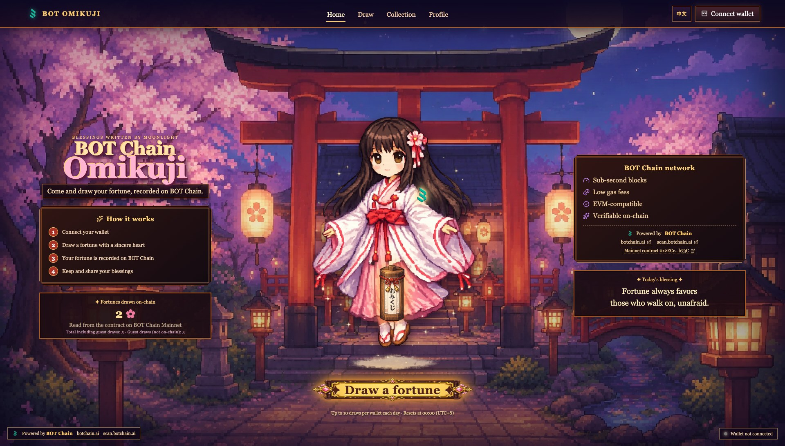

# BOT Omikuji

[简体中文](./README.zh-CN.md)

A pixel-art shrine where visitors draw a daily omikuji fortune that is recorded on **BOT Chain Mainnet** (chain ID 677).

Entertainment only: draws are free apart from gas, and there is no token, prize, payment or anything of value attached to a result.



## Status

| Item | State |
| --- | --- |
| Contract, backend, frontend | Done |
| Automated tests (unit, contract, database, local end-to-end) | Passing locally |
| BOT Chain Mainnet contract | Deployed and source-verified: [`0x2ecc765e…7b73c`](https://scan.botchain.ai/address/0x2ecc765e201feee88adc81cd4abad62cf327b73c#code) (block 26794339) |
| Production site | **Live** at https://botchain-omikuji.vercel.app since 2026-10-16 (first verified mainnet draw: [`0x36ec…9c6f`](https://scan.botchain.ai/tx/0x36ec858cd24ffacecbbdd413565aeae6f5d2304bbd46cf958397ecdbf81a9c6f)) |

Deployment record: [`deployments/botchain-mainnet.json`](./deployments/botchain-mainnet.json).

## Features

- Moonlit pixel shrine, animated shrine maiden, sakura particles and a staged draw ritual.
- Real `drawFortune` transactions on BOT Chain. The UI shows the fortune only after it has decoded the `FortuneDrawn` event from a successful receipt.
- Seven weighted fortunes (大吉 to 大凶), with up to 10 draws per wallet per UTC+8 day, enforced by the contract.
- Each wallet's history is read straight from contract storage, so it survives reloads, reconnects and new devices without any backend.
- Wallet-first accounts: the wallet is the account. A free Sign-In with Ethereum signature (chain 677, one-time server nonce, 5-minute expiry; no transaction, no gas) unlocks favorites and a nickname. Every indexed draw is re-verified on chain by the backend.
- Simplified Chinese and English UI (i18next), switchable in place. Translation rules: [`docs/localization-style-guide.md`](./docs/localization-style-guide.md).
- Off-chain guest trials. They are labelled as such, have no transaction hash and are never counted as on-chain draws.

## Network

| | |
| --- | --- |
| Network | BOT Chain Mainnet |
| Chain ID | 677 (`0x2a5`) |
| RPC | https://rpc.botchain.ai |
| Currency | BOT |
| Explorer | https://scan.botchain.ai |
| Website | https://botchain.ai |

## Architecture

```text
contracts/FortuneContract.sol        Draws, daily limit, per-wallet history (getFortunes)
supabase/functions/_shared/          Shared by frontend, Edge Functions and scripts:
  botchain.ts                        chain constants, ABI, contract-address validation
  verifyDraw.ts                      receipt + event + storage verification
  handlers.ts                        record-draw / wallet-claim logic (tested in Node)
supabase/functions/record-draw       Public indexer (takes a tx hash only)
supabase/functions/wallet-claim      Nonce / signature binding and claim sync
supabase/migrations/                 Schema for a NEW Supabase project, pinned to chain 677
src/                                 React 19 + Vite + wagmi + RainbowKit frontend
scripts/                             Deploy (dry run by default), deployment check, tx verification
e2e/                                 Local end-to-end run in Chrome against a local node
```

The contract, frontend, Edge Functions and scripts all import one module for chain parameters and the ABI, so they cannot drift apart.

## Development

```bash
npm ci
cp .env.example .env.local   # fill in values as needed
npm run dev
```

When `VITE_CONTRACT_ADDRESS` is empty, the app runs in a clearly labelled "contract not configured" state. It never falls back to an old contract.

## Tests

```bash
npm run typecheck
npm test                 # unit + backend handler + database/RLS tests (PGlite)
npm run contract:compile
npm run test:contract    # contract + on-chain verification tests (Hardhat)
npm run build
npm run test:e2e         # real UI in Chrome against a LOCAL node forked from BOT Chain
```

`test:e2e` runs on a node on your machine that reports chain ID 677. It does not touch BOT Chain Mainnet, so a passing run does not show that anything works on mainnet.

## Deployment

See [docs/DEPLOYMENT.md](./docs/DEPLOYMENT.md) for the contract, Supabase and Vercel steps, and [docs/RELEASE_CHECKLIST.md](./docs/RELEASE_CHECKLIST.md) for the launch and acceptance checklist.

## Randomness

BOT Chain returns a constant for `block.prevrandao`. The contract therefore mixes the previous block hash, timestamp, sender and counters. That is predictable for validators and simulators, which is acceptable only because results carry no value. See the notes in the contract.

## Credits

Game, art and design by Caro.
